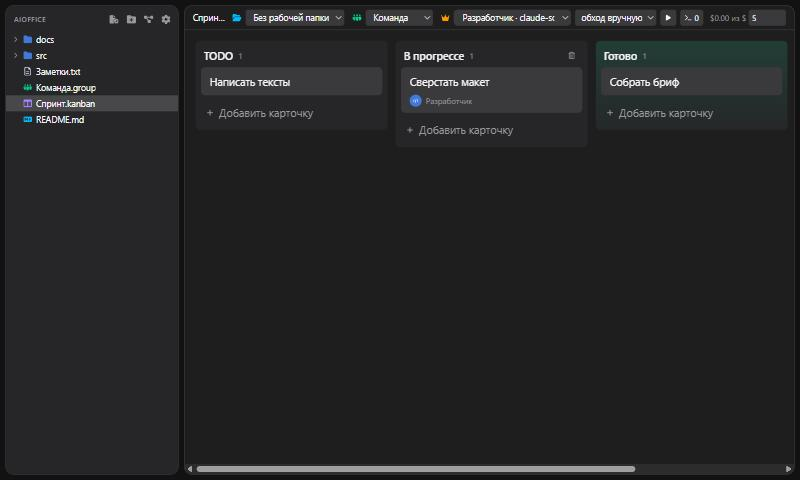

# AIOffice

A desktop office where AI agents work for you. Write Markdown, plan on kanban boards, and let a team of
OpenRouter-powered agents do the tasks in a sandboxed folder while a master agent reviews their work.



## Features

- Markdown and plain-text editor with a project file explorer
- Kanban boards: worker agents complete cards, a master agent assigns, reviews and restarts them
- Agent groups with any OpenRouter model, per-card token and cost tracking, run logs
- Offline voice input (Whisper), `Ctrl+D` to dictate

## Development

Requires [Rust](https://rustup.rs), [Bun](https://bun.sh), the Tauri CLI (`cargo install tauri-cli`),
and CMake + LLVM for the Whisper build (`LIBCLANG_PATH` pointing to LLVM's `bin`).

```sh
bun install
cargo tauri dev
```
